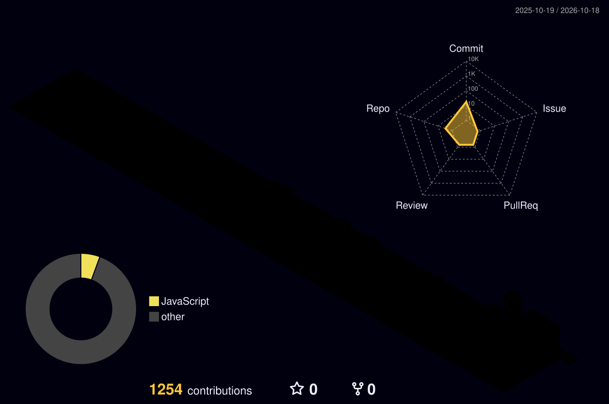

 

  

  

 

<picture>
  <source media="(prefers-color-scheme: dark)" srcset="https://raw.githubusercontent.com/ayubjon-dev/ayubjon-dev/output/snake-dark.svg"/>
  <source media="(prefers-color-scheme: light)" srcset="https://raw.githubusercontent.com/ayubjon-dev/ayubjon-dev/output/snake-light.svg"/>
  
</picture>

