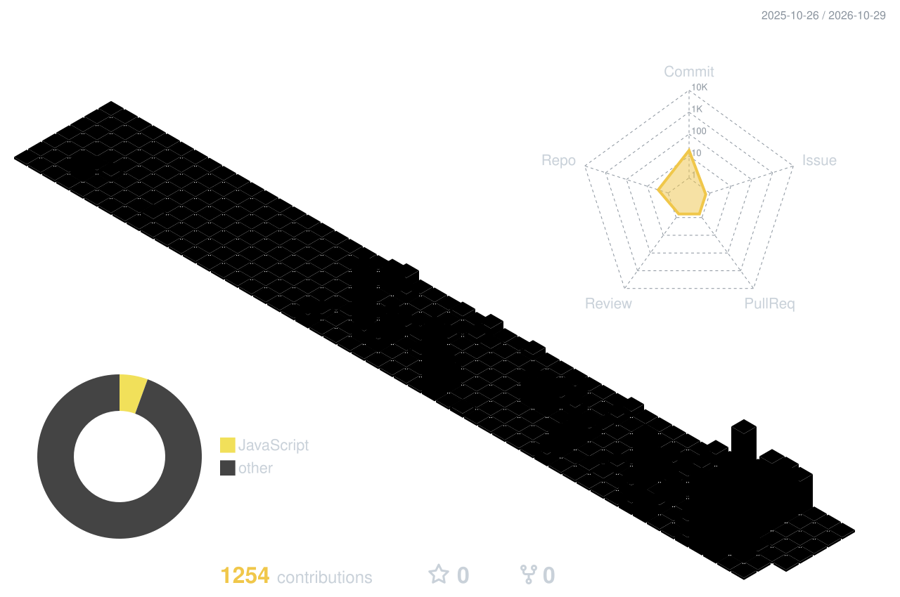

<picture>
  <source media="(prefers-color-scheme: dark)" srcset="./assets/header-dark.svg"/>
  <source media="(prefers-color-scheme: light)" srcset="./assets/header-light.svg"/>
  
</picture>

 

  

  

<picture>
  <source media="(prefers-color-scheme: dark)" srcset="./profile-3d-contrib/rainbow-dark.svg"/>
  <source media="(prefers-color-scheme: light)" srcset="./profile-3d-contrib/rainbow-light.svg"/>
  
</picture>

 

